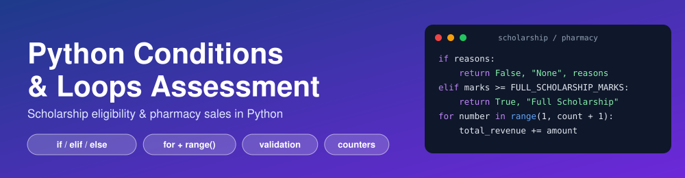
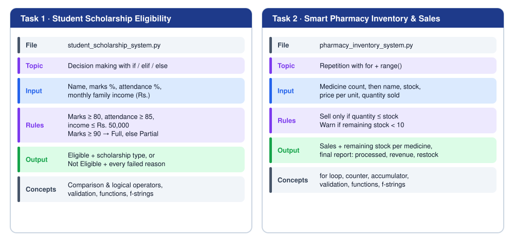
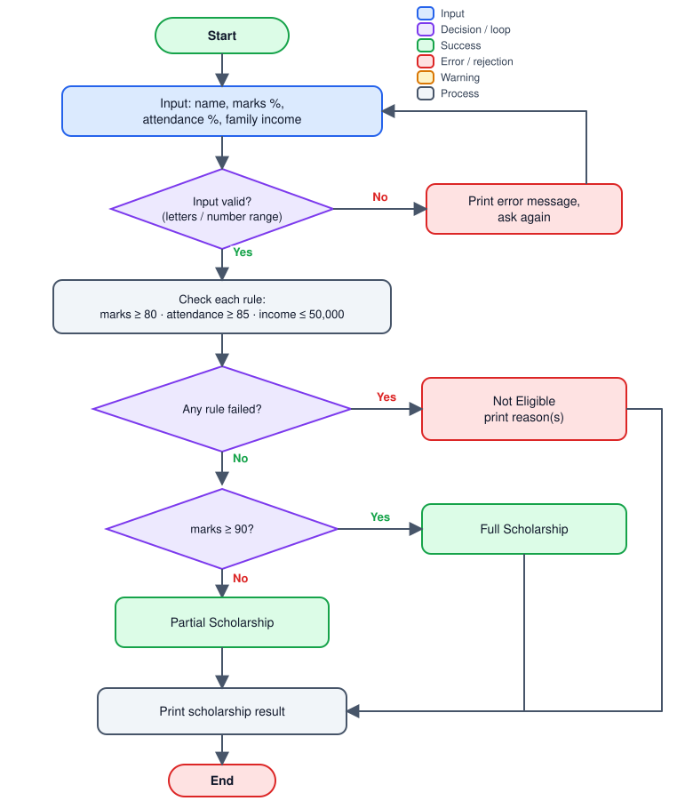
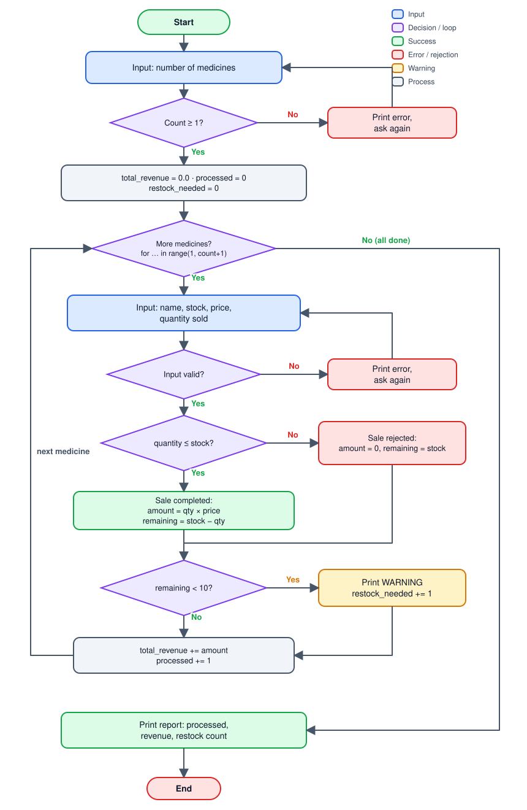
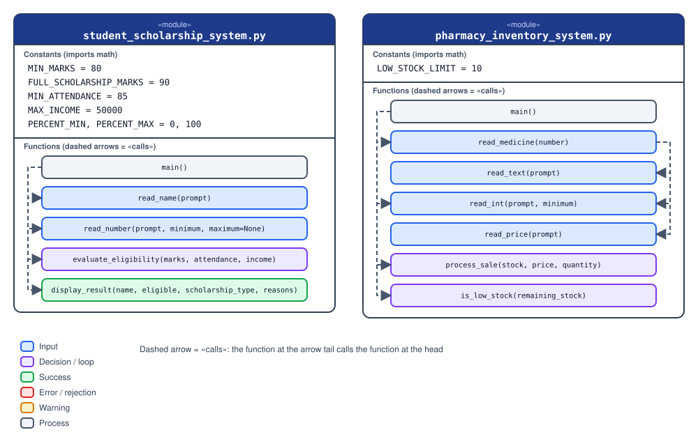

<p align="center"></p>

## 1. Project Overview

Two beginner-friendly Python programs that show decision making (`if` / `elif` / `else`) and repetition (`for` + `range()`) with practical examples. No external libraries are needed.

| Task | File | Topic |
|------|------|-------|
| 1 | `student_scholarship_system.py` | Conditions, comparison and logical operators, validation |
| 2 | `pharmacy_inventory_system.py` | `for` loop, counters, accumulator, validation |

<p align="center"></p>

## 2. Folder Structure

```text
python-conditions-loops-assessment/
├── assets/
│   ├── banner.svg
│   ├── overview.svg
│   ├── pharmacy_flow.svg
│   ├── scholarship_flow.svg
│   └── uml_diagram.svg
├── pharmacy_inventory_system.py
├── README.md
└── student_scholarship_system.py
```

`assets/` holds only the README images. The two `.py` files and `README.md` match the structure required by the brief.

## 3. Task 1: Student Scholarship Eligibility System

**Summary.** `student_scholarship_system.py` reads a student's name, academic marks, attendance and monthly family income. It checks every rule, then prints either the scholarship type or every reason for rejection.

**Rules**

- Marks must be at least 80%.
- Attendance must be at least 85%.
- Monthly family income must be Rs. 50,000 or less.
- All rules met and marks of 90% or above: **Full Scholarship**.
- All rules met and marks from 80% to below 90%: **Partial Scholarship**.
- Any rule failed: **Not Eligible**, with every reason listed.

### Program Flow

<p align="center"></p>

### Code Methods Description

| Method / section | Purpose |
|------------------|---------|
| Constants (`MIN_MARKS`, `FULL_SCHOLARSHIP_MARKS`, `MIN_ATTENDANCE`, `MAX_INCOME`, `PERCENT_MIN`, `PERCENT_MAX`) | Keep every rule threshold in one place instead of magic numbers |
| `read_name(prompt)` | Repeats the prompt until the name is non-empty and has letters and spaces only |
| `read_number(prompt, minimum, maximum=None)` | Repeats the prompt until a finite number inside the allowed range is entered; returns a float |
| `evaluate_eligibility(marks, attendance, income)` | Applies the rules with `if` / `elif` / `else`; returns `(eligible, scholarship_type, reasons)` |
| `display_result(name, eligible, scholarship_type, reasons)` | Prints the status, the scholarship type or the list of reasons |
| `main()` | Reads the four inputs, calls the functions above and handles early end of input |

### Input Validation

- Name: cannot be blank and cannot contain digits or symbols.
- Marks and attendance: must be a number from 0 to 100.
- Income: must be a number of 0 or more.
- Text such as `abc`, `nan` or `inf` is rejected with an error message, and the question is asked again.
- If input ends early (EOF), the program prints a clear error and exits without a crash.

### Expected Results

- `92 / 90 / 40000` gives **Eligible: Full Scholarship**.
- `85 / 88 / 45000` gives **Eligible: Partial Scholarship**.
- Boundary values 80, 85 and 50000 are accepted; 79.9, 84.9 and 50001 fail alone.
- Several failed rules are all listed, not just the first one.

## 4. Task 2: Smart Pharmacy Inventory & Sales Management System

**Summary.** `pharmacy_inventory_system.py` asks how many medicines to process, then loops once per medicine. Each sale is completed only when stock is enough. The program updates stock, adds to total revenue and prints a final report.

**Rules**

- A sale is completed only if quantity sold is not more than available stock.
- Sales amount is quantity sold multiplied by unit price; remaining stock is stock minus quantity.
- A rejected sale adds Rs. 0 revenue and leaves stock unchanged.
- A warning is shown when remaining stock is below 10 units.
- `total_revenue` is the accumulator; `processed` and `restock_needed` are counters.

### Program Flow

<p align="center"></p>

### Code Methods Description

| Method / section | Purpose |
|------------------|---------|
| `LOW_STOCK_LIMIT` | Constant (10) for the low-stock warning |
| `read_text(prompt)` | Repeats the prompt until a non-empty value is entered |
| `read_int(prompt, minimum)` | Repeats the prompt until a whole number of at least `minimum` is entered |
| `read_price(prompt)` | Repeats the prompt until a finite price greater than 0 is entered |
| `process_sale(stock, price, quantity)` | Returns `(sale_completed, sales_amount, remaining_stock)` |
| `is_low_stock(remaining_stock)` | Returns `True` when remaining stock is below `LOW_STOCK_LIMIT` |
| `read_medicine(number)` | Collects name, stock, price and quantity sold for one medicine |
| `main()` | Runs the `for number in range(1, count + 1)` loop, updates the counters and accumulator, prints the report |

### Input Validation

- Number of medicines: whole number, at least 1.
- Medicine name: cannot be blank.
- Available stock: whole number, 0 or more.
- Price per unit: number greater than 0.
- Quantity sold: whole number, at least 1.
- Invalid values show an error message and the question is asked again; early end of input prints a clear error and exits.

### Expected Results

- The brief's sample (Panadol and Brufen) gives revenue **Rs. 450.00** and **1** medicine needing restock.
- Remaining stock of exactly 10 gives no warning; 9 or less does.
- Quantity above stock gives "Sale rejected", Rs. 0.00 sales and unchanged stock.
- Every entered medicine counts as processed, even when its sale is rejected.

## 5. UML Diagram

I chose a **module diagram** because both programs are procedural (no classes): it shows each file's constants and functions, and the `«calls»` arrows show which function calls which.

<p align="center"></p>

## 6. Concepts and Techniques Used

- Variables and data types (`str`, `int`, `float`, `bool`, tuples)
- `input()` and `print()`
- `if`, `elif` and `else` statements
- Comparison operators (`>=`, `<=`, `<`, `>`) and logical operators (`or`, `and`, `not`)
- `for` loop with `range()`
- Counters (`processed`, `restock_needed`) and an accumulator (`total_revenue`)
- Arithmetic operators (`*`, `-`, `+=`)
- `while True` loops for input validation, `try` / `except` for `ValueError` and `EOFError`
- Functions with return values, constants, f-strings and number formatting

## 7. How to Run

**Requirements**

- Python 3.x (no external libraries)
- Visual Studio Code or another editor (recommended)

**Clone and open the project**

```bash
git clone https://github.com/aliraza019013-droid/python-conditions-loops-assessment.git
cd python-conditions-loops-assessment
```

**Run Task 1**

```bash
python student_scholarship_system.py
```

**Run Task 2**

```bash
python pharmacy_inventory_system.py
```

**Alternative commands:** use `python3 student_scholarship_system.py` (macOS / Linux) or `py student_scholarship_system.py` (Windows launcher), and the same pattern for `pharmacy_inventory_system.py`.

## 8. Sample Execution

All outputs below were produced by running the real programs.

### Task 1

**Success: Full Scholarship (sample from the brief)**

```text
=== Student Scholarship Eligibility System ===
Enter student name: Ali
Enter academic marks (0-100): 92
Enter attendance percentage (0-100): 90
Enter monthly family income (Rs.): 40000

--- Scholarship Result ---
Student Name: Ali
Scholarship Status: Eligible
Scholarship Type: Full Scholarship
```

**Failure: two rules fail, both reasons shown**

```text
=== Student Scholarship Eligibility System ===
Enter student name: Usman
Enter academic marks (0-100): 70
Enter attendance percentage (0-100): 80
Enter monthly family income (Rs.): 40000

--- Scholarship Result ---
Student Name: Usman
Scholarship Status: Not Eligible
Reason(s):
  - Academic marks below 80% (got 70%)
  - Attendance below 85% (got 80%)
```

**Edge case: invalid inputs, then valid ones**

```text
=== Student Scholarship Eligibility System ===
Enter student name: 
Error: Name cannot be empty. Please try again.
Enter student name: Ali123
Error: Name must contain letters and spaces only.
Enter student name: Ali Raza
Enter academic marks (0-100): abc
Error: Please enter a valid number.
Enter academic marks (0-100): 101
Error: Value must be between 0 and 100.
Enter academic marks (0-100): -5
Error: Value must be between 0 and 100.
Enter academic marks (0-100): 92
Enter attendance percentage (0-100): ninety
Error: Please enter a valid number.
Enter attendance percentage (0-100): 90
Enter monthly family income (Rs.): -1
Error: Value must be at least 0.
Enter monthly family income (Rs.): 40000

--- Scholarship Result ---
Student Name: Ali Raza
Scholarship Status: Eligible
Scholarship Type: Full Scholarship
```

### Task 2

**Success: sample from the brief**

```text
=== Smart Pharmacy Inventory & Sales Management System ===
How many different medicines do you want to process? 2

Medicine 1:
Medicine name: Panadol
Available stock: 50
Price per unit: 20
Quantity sold: 15

Medicine: Panadol
Total Sales: Rs. 300.00
Remaining Stock: 35

Medicine 2:
Medicine name: Brufen
Available stock: 8
Price per unit: 30
Quantity sold: 5

Medicine: Brufen
Total Sales: Rs. 150.00
Remaining Stock: 3
WARNING: Low stock! Restocking required.

--- Final Pharmacy Report ---
Total Medicines Processed: 2
Total Pharmacy Revenue: Rs. 450.00
Medicines Requiring Restocking: 1
```

**Failure: sale rejected, stock too low**

```text
=== Smart Pharmacy Inventory & Sales Management System ===
How many different medicines do you want to process? 1

Medicine 1:
Medicine name: Augmentin
Available stock: 5
Price per unit: 200
Quantity sold: 6

Medicine: Augmentin
Sale rejected: only 5 units in stock, 6 requested.
Total Sales: Rs. 0.00
Remaining Stock: 5
WARNING: Low stock! Restocking required.

--- Final Pharmacy Report ---
Total Medicines Processed: 1
Total Pharmacy Revenue: Rs. 0.00
Medicines Requiring Restocking: 1
```

**Edge case: remaining stock exactly 10, no warning**

```text
=== Smart Pharmacy Inventory & Sales Management System ===
How many different medicines do you want to process? 1

Medicine 1:
Medicine name: Aspirin
Available stock: 25
Price per unit: 12.5
Quantity sold: 15

Medicine: Aspirin
Total Sales: Rs. 187.50
Remaining Stock: 10

--- Final Pharmacy Report ---
Total Medicines Processed: 1
Total Pharmacy Revenue: Rs. 187.50
Medicines Requiring Restocking: 0
```

## 9. Test Cases

Every case below was run against the real code and matched the expected result.

### Task 1: `student_scholarship_system.py`

| # | Scenario | Inputs | Expected result |
|---|----------|--------|-----------------|
| 1 | Sample from brief: all rules met, marks >= 90 | `Ali, 92, 90, 40000` | Eligible - Full Scholarship |
| 2 | Marks in 80-89 range, other rules met | `Sara, 85, 88, 45000` | Eligible - Partial Scholarship |
| 3 | Boundary: marks 90, attendance 85, income 50000 | `Hina, 90, 85, 50000` | Eligible - Full Scholarship |
| 4 | Boundary: marks 80, attendance 85, income 50000 | `Bilal, 80, 85, 50000` | Eligible - Partial Scholarship |
| 5 | Only marks fail (79.9) | `Omar, 79.9, 90, 30000` | Not Eligible - marks reason |
| 6 | Only attendance fails (84.9) | `Zain, 88, 84.9, 30000` | Not Eligible - attendance reason |
| 7 | Only income fails (50001) | `Ayesha, 95, 95, 50001` | Not Eligible - income reason |
| 8 | Two rules fail (marks, attendance) | `Usman, 70, 80, 40000` | Not Eligible - 2 reasons |
| 9 | All three rules fail | `Fatima, 50, 60, 90000` | Not Eligible - 3 reasons |
| 10 | Invalid inputs then valid (empty/digit name, text, out of range, negative) | `(blank), Ali123, Ali Raza, abc, 101, -5, 92, ninety, 90, -1, 40000` | Errors shown, re-prompts, then Full Scholarship |
| 11 | Input ends early (EOF) | `Ali, 92` | Clear error message, no crash |

### Task 2: `pharmacy_inventory_system.py`

| # | Scenario | Inputs | Expected result |
|---|----------|--------|-----------------|
| 1 | Sample from brief: Panadol and Brufen | `2, Panadol, 50, 20, 15, Brufen, 8, 30, 5` | Rs. 450.00 revenue, 1 restock |
| 2 | Boundary: remaining stock exactly 10 (no warning) | `1, Aspirin, 25, 12.5, 15` | Rs. 187.50, no warning |
| 3 | Boundary: remaining stock 9 (warning) | `1, Cetirizine, 25, 10, 16` | Rs. 160.00, warning |
| 4 | Sale uses all stock (remaining 0) | `1, Insulin, 10, 100, 10` | Rs. 1000.00, warning |
| 5 | Insufficient stock: sale rejected | `1, Augmentin, 5, 200, 6` | Rs. 0.00, stock unchanged 5, warning |
| 6 | Mixed run: sale, rejection, low stock | `3, Panadol, 100, 20, 30, Disprin, 4, 15, 9, Calpol, 12, 45.5, 2` | Rs. 691.00 revenue, 1 restock (rejected sale earns Rs. 0) |
| 7 | Invalid inputs then valid (count, name, stock, price, quantity) | `0, two, 2, (blank), Panadol, -3, abc, 50, 0, -5, 20, 0, x, 15, Brufen, 8, 30, 5` | Errors shown, re-prompts, then Rs. 450.00 |
| 8 | Single medicine, large stock | `1, Vitamin C, 500, 8.75, 120` | Rs. 1050.00, no warning |
| 9 | Input ends early (EOF) | `2, Panadol, 50` | Clear error message, no crash |

## Conclusion

The Student Scholarship Eligibility System demonstrates decision making with conditional statements. The Smart Pharmacy Inventory & Sales Management System demonstrates repetition with `for` loops, conditions inside loops, counters and accumulators.

**Project Name:** Python Conditions & Loops Assessment  
**Language:** Python 3  
**Repository Name:** `python-conditions-loops-assessment`

---

<p align="center"><b>Author:</b> Muhammad Ali Raza · <b>GitHub:</b> <a href="https://github.com/aliraza019013-droid/python-conditions-loops-assessment">aliraza019013-droid/python-conditions-loops-assessment</a></p>
